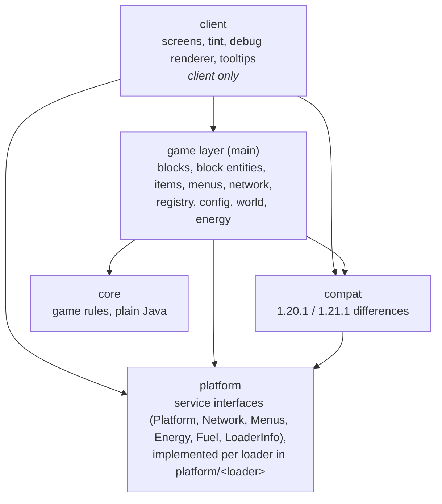

# Architecture

> On the branch `1.12` this guide describes the main branch (`1.20.1+`); the 1.12.2 port has the same `core/` and the same class names, without the Stonecutter build and the `platform/` layer. See `CLAUDE.md` §5 on that branch.

A guide to the code of Open Modular Lighting (OML) for people working on it: how it is layered, what lives where, how the main flows run, and how to add the common things.
It describes the code as it is; where it falls short of its own rules, the last section says so.

Building, running and the Stonecutter commands are in the README and in `CLAUDE.md` (section 4).
The gameplay rules (beam shapes, state machine, power) are specified in `CLAUDE.md` (sections 6.3 to 6.10); this document shows where they live in the code.

## The idea in one paragraph

A **light** (floodlight, grow light, fluorescent light, cube light, UV floodlight) is a block with a block entity that owns the state: on or off, inverted, power, mode and the cached shape of its beam.
The beam itself is made of **light blocks** (invisible phantom lights, or UV lights) that the light places in the air along the beam and then leaves in place.
Turning a light on or off only switches the `LIT` blockstate of those light blocks; they are placed and removed only when the beam changes shape or the light is broken.
All game rules (beam shapes, which positions a ray reaches, which sources keep a light block alive, the on/off state machine, energy and fuel formulas) are plain Java in `core`, without any Minecraft class, so they are unit-tested in milliseconds.
The Minecraft-facing code around it translates between the game and the core and is kept as thin as possible.

## Layers

An arrow means "may use".
The game layer and `compat` reach the loader only through the service interfaces in `platform`; `platform/<loader>` implements them and installs them first thing in its entrypoint.
The one exception to the arrows are the entrypoints in `platform/<loader>`: they start the mod and wire the game layer to the loader (registration steps, capabilities, events), so they reference game classes such as `ModTileEntities`.
The other directions are forbidden:

- **core** uses only Java and itself: no Minecraft, loader or other OML packages.
  The `verifyCoreIsolation` task (part of `check`) fails the build if a file under `core/` imports `net.minecraft`, `net.fabricmc`, `net.neoforged`, `net.minecraftforge`, `com.mojang`, `team.reborn` or a non-core OML package, and `ArchitectureTest.coreDependsOnlyOnCoreAndJava` checks the same on the compiled classes.
- **main** code never uses **client** code: the client classes do not exist on a dedicated server.
  The split source sets make it a compile error on every node (the `client` source set sees `main`, not the other way round), and `ArchitectureTest.mainCodeNeverDependsOnClientCode` checks it on the compiled classes.

### How core talks to the game

The core defines small interfaces for what it needs from the world; the game layer implements them.
This is the only place where the two meet, and the reason the core can be tested with fakes (`src/test/.../core/light/TestWorld`).

| Core interface (`core`) | Implemented by (game layer) | What it gives the core |
| --- | --- | --- |
| `light.LightWorld` | `world.LevelLightWorld` | classifies a block position as a `Cell`: air, phantom light, UV light, opaque, transparent or unloaded |
| `state.PowerSource` | `energy.ElectricPower`, `energy.FuelPower` (through `energy.LightPower`) | whether the light can run this tick, and paying for it |
| `cluster.ClusterNode` | `blockentity.PanelLightTileEntity` | who a light is connected to, for the shared energy of touching lights |
| `energy.EnergyAccess` | the lights' `getEnergyAccess(side)` (the buffer of `energy.ElectricPower`, or `energy.ClusterEnergy.View` for panel lights) | what other blocks may do with a light's energy (insert; extract is never allowed) |

Positions in core are the `Pos` record and directions the `Facing` enum (same ordinal order as `Direction`); `world.Positions` converts both ways.
The block entities own one core object each and forward to it: `FloodlightTileEntity` → `LightController`, `LightTileEntity` → `LightSources`, `PanelLightTileEntity` → `Cluster`.
A light's beam is the game-layer class `blockentity.LightBeam`, which calls `BeamCaster` and `ShapeDiff` and keeps the cached shape.

## Where things live

Source sets (Loom split source sets on Fabric, the same split built by hand on NeoForge and Forge, plus the two test sets):

| Source set | Contents | Shipped |
| --- | --- | --- |
| `src/main` | everything that runs on both sides, including `fabric.mod.json`, `neoforge.mods.toml` and `mods.toml` (Forge; all templated) | yes |
| `src/client` | screens, tint, disguise models, debug renderer, client networking | yes, client only |
| `src/test` | JUnit tests of the core and the config, and the architecture rules (`ArchitectureTest`) | no |
| `src/gametest` | in-world GameTests as a separate test mod (own mod id), shared by all loaders | no |

Packages below `omtteam.openmodularlighting` (main):

| Package | Responsibility |
| --- | --- |
| `OML` | `MOD_ID`, `OML.id(path)`, `init()` and `registrationSteps()`, used by every loader entrypoint |
| `core.math` | `Pos`, `Facing`, `Rotation` (rotates the shapes to the facing) |
| `core.beam` | `BeamShape` (the ray patterns), `BeamMode` and `GrowMode`, `Spacing` (the thinning of light blocks along a beam), `Ray` |
| `core.light` | `BeamCaster` (walks the rays), `LightWorld` and `Cell`, `LightType`, `LightSources` (all and active sources of a light block), `ShapeDiff` |
| `core.state` | `LightController` (the on/off state machine), `PowerSource`, `FuelTimer`, `RecheckTimer` |
| `core.cluster` | `Cluster` and `ClusterNode`: connected groups with join, leave and split, generic enough to reuse for multiblocks |
| `core.energy` | `EnergyStore` (the buffer) and `EnergyAccess` |
| `core.formula` | `CarbonFuel`, `GrowChance`, `EnergyCost` |
| `block` | `FloodlightBlock` (base of every light: `FACING`, `LIT`, drops) with its subclasses; `FloodlightInteraction` (right-click); `LightBlock` (base of the phantom and UV light blocks); `PanelShapes` |
| `blockentity` | `FloodlightTileEntity` (base of every light) and subclasses, `LightBeam` (its cached beam and the re-cast); `LightTileEntity` (sources of a light block) with `PhantomLightTileEntity` and `UvLightTileEntity`; `LightSourceTileEntity` |
| `world` | `LightBlocks` (place, switch and remove light blocks), `LevelLightWorld`, `Positions` |
| `energy` | `LightPower` with `ElectricPower` and `FuelPower`, `ClusterEnergy`, `Batteries` |
| `inventory` | `ItemAccess`: the slot range and filters other blocks see (wrapped by the loader adapters) |
| `menu` | the container menus (with the disguise slot) and `LongContainerData` |
| `camo` | disguise of the floodlights: `CamoBlock` (marker of the lights that can be disguised), `CamoRules` (which blocks are valid), `CamoData` (the disguise and its NBT) |
| `registry` | `ModBlocks`, `ModItems` (the crafting items and the light debug tool are plain `Item`s; what the tool does is in `FloodlightInteraction` and `client.render.LightBlockDebugRenderer`), `ModTileEntities`, `ModMenus`, `ModCreativeTabs`, `ModDamageTypes`, `RegistrationStep` |
| `network` | `OMLPackets` (all packet types) and `ConfigSyncPacket` |
| `config` | the JSON config: `ConfigData` (fields), `@Comment`, `@Range`, `ConfigWriter`, `ConfigRanges`, `ConfigValidator`, `OMLConfig` (load, save, sync) |
| `compat` | every 1.20.1 / 1.21.1 difference (`VersionCompat`, `CompatTileEntity`, `InteractiveBlock`, `MenuCompat`, `network/`), `CommonTags`, the recipe condition, and the optional Jade plugin (`compat/jade`) |
| `platform` | the loader services shared code calls (`Platform` holding `PlatformServices`: `LoaderInfo`, `Fuel`, `Network`, `Menus`, `Energy`); `platform.fabric`, `platform.neoforge` and `platform.forge` hold the entrypoints and implementations and only compile for their loader |
| `datagen` | recipes, loot tables, tags, damage types (Fabric only, generated per version) |

The block and block entity hierarchies mirror each other:

The upper tree in each half is the **lights** (they have a `FACING`, a GUI and a tick); the lower one is the **light blocks** they place (no GUI, no tick except the UV damage).

## How the main flows run

### Startup

The loader entrypoint (`OMLFabric`, `OMLNeoForge`, `OMLForge`) first installs the platform services, then calls `OML.init()`.
The order matters:

1. `OMLPackets.init()`: the packet types (NeoForge accepts them only until its payload registration event).
2. `OMLConfig.init()`: blocks and recipes read the config, so it comes before any registration.

Then the registrations of `OML.registrationSteps()`: blocks, items, block entities, menus, creative tab.
Fabric runs them in this order; NeoForge and Forge run each in the `RegisterEvent` of its registry and fail at common setup if one never ran.
A new registry class gets a `RegistrationStep` in that list, not a call in an entrypoint.

Last, the entrypoint wires its loader to the shared code: the item and energy access of the lights (`FabricBlockLookups`, NeoForge capabilities, Forge capabilities attached in `AttachCapabilitiesEvent` by `ForgeLightCapabilities`), block use (`InteractiveBlock.handleUse`), the config sync on join and the recipe condition.

On the client, the loader client entrypoint (`OMLFabricClient`, `OMLNeoForgeClient`, `OMLForgeClient`; Forge 1.20.1 has no client-only `@Mod` classes, so `OMLForge` constructs it by name) installs the client platform services and calls `OMLClient.init()`.
It then registers what `OMLClient` lists with its loader: screens, the dye tint, tooltips and the debug renderer, and wraps the models of the `CamoBlock`s in the loader's disguise model (`FabricCamoModel`, `NeoForgeCamoModel`, `ForgeCamoModel`).
Render layers are the one thing kept twice: `BlockRenderLayerMap` on Fabric, `"render_type"` in the block model JSON on NeoForge and Forge.

### A light's tick (server)

`FloodlightTileEntity.serverTick`:

1. `beforePower`: panel lights keep their cluster up to date and pull energy from it.
2. `power().prepare`: charge from the battery slot, or burn the next fuel item.
3. A re-cast is flagged if the shape key (mode, ranges) differs from the one the cached shape was cast with (`LightBeam.needsRecast`), or if the periodic `RecheckTimer` fires (every 10 to 30 s).
4. `LightController.tick(redstone, power, timeout)` returns a `TickResult`: re-cast or not, switch on, off or neither, and whether the light ran (and paid) this tick.
5. A re-cast runs first (`LightBeam.recast`), then the switch (`LightBeam.switchLights`), then the light's own `LIT` is set.
6. `afterTick` is the hook of subclasses (the grow light's growth ticks).

The state machine itself, with the timeout against flicker, is `core.state.LightController`; it knows nothing about blocks.

### Casting a beam

`LightBeam.recast`, called from the tick and at once from `FloodlightTileEntity.shapeChanged` (mode change); the beam reads the shape, facing, light type and on/off state from its light:

1. `BeamCaster.cast(shape, origin, facing, lightType, new LevelLightWorld(level))` walks every ray of the shape and returns the positions that should hold a light block.
   A ray stops at an opaque or unloaded cell, passes through transparent ones without a position, and the cone rules (the inner ray is skipped if its outer ray was blocked early) live here.
2. `ShapeDiff.between(cached, cast)` gives the positions that dropped out.
   For each, `LightBlocks.leave` removes this light as a source; a light block with no sources left removes itself.
3. Every cast position is joined through `LightBlocks.join`: it places a light block in air (or where `LightBlock.canReplace` allows), then adds this light as a source.
   Joining positions that are already covered is a no-op, so this also repairs light blocks lost while a chunk was unloaded.
4. The positions that joined become the cached shape (a `long[]` saved with the block entity, so a reload does not need a cast).

`BeamCasterTest` checks `BeamCaster` against reference loops in the test sources (`Legacy1710Beams`, filtered by the same thinning) in random worlds.

### Light blocks and their sources

A `LightTileEntity` stores two lists: `sources` (every light that reaches this block) and `activeSources` (those that are on), in `core.light.LightSources`.
Every change returns an `Effect` (`NONE`, `TURN_ON`, `TURN_OFF`, `REMOVE`) which `LightBlocks.apply` carries out on the block: `LIT` is `!activeSources.isEmpty()`, and the block goes away when `sources` is empty.
So several floodlights can share one block, and it stays lit as long as one of them is on.

`LightBlocks` always uses `LightBlocks.FLAGS` (clients are told, no neighbour or shape updates).
Without that, every toggle would update the next light block and start re-cast chains.

Light blocks do not tick (there can be thousands).
Instead they react to the world:

- `neighborChanged` and `onRemove` call `requestRecastOfSources()`, which only flags the sources; the light re-casts on its next tick, never inside the neighbour callback.
- `randomTick` calls `LightTileEntity.refresh()`: sources whose block entity is gone, or no longer covers this position, are dropped, `LIT` is corrected and the block removes itself if nothing is left.
  Sources in unloaded chunks are left alone (`SourceStatus.UNKNOWN`).

The UV light block is the exception that ticks: while lit it hurts every `LivingEntity` inside it once a second (`UvLightTileEntity.serverTick`).

### Power and fuel

A light's `LightPower` is chosen by its block entity: `ElectricPower` (an `EnergyStore` of 50 000 E plus a battery slot) or `FuelPower` (a `FuelTimer` plus a fuel slot).
`prepare` runs before the logic each tick, `PowerSource.canRun()` / `run()` is what `LightController` calls.
The numbers are in `core.formula` (`EnergyCost`, `CarbonFuel`, `GrowChance`).

Outside access goes through the loader:

- Energy: `core.energy.EnergyAccess`, exposed as Team Reborn Energy on Fabric (`FabricEnergyStorages`) and as an FE capability on NeoForge (`NeoForgeEnergyHandler`) and Forge (`ForgeEnergyHandler`).
  Only inserting is possible; there is no extraction.
- Items: `inventory.ItemAccess.insertOnly`, exposed as `ItemStorage.SIDED` on Fabric (`FabricItemStorages`) and as `IItemHandler` on NeoForge and Forge.
- Battery slot and fuel values: `platform.Energy` and `platform.Fuel`.

### Shared energy of panel lights

Fluorescent, grow and cube lights (`PanelLightTileEntity`) that touch and face the same way form a `core.cluster.Cluster` (cube lights: any face, cube lights only).
The cluster is in memory only: a light joins on its first tick, leaves in `setRemoved`, and a possible split is found in `refresh()` once per tick, so breaking a wall of lights costs one flood fill.
Each light keeps its own buffer; `ClusterEnergy` shows the whole cluster to the outside (inserting fills the emptiest light first) and lets a light that cannot pay take from the fullest others.

### A click on a light

Right-click handling does not use vanilla's `use` methods, because they differ between 1.20.1 and 1.21.1.
The loader's block-use event calls `InteractiveBlock.handleUse`, which calls `FloodlightBlock.onUse`; that hands it to `FloodlightInteraction`, one method per action:

- sneak with an empty hand: toggle invert; stick or wrench: `configure` (cycle the mode, turn the small fluorescent light); wrench plus sneak: dismantle; dye or wool: set the colour;
- anything else opens the menu: `MenuCompat.open` → `platform.Menus` → `ElectricFloodlightContainer` or `CarbonFloodlightContainer`.
  On a `CamoBlock`, `FloodlightContainer` adds the phantom disguise slot: a click there calls `FloodlightTileEntity.setCamo` on the server.

Changes that affect the beam (`setMode`) end in `shapeChanged()`, which re-casts at once.
The server is the only place that changes state; the screens only show it (the menus sync energy and burn time with `LongContainerData`) and the colour and the disguise reach the client in the block entity's update tag.
The disguise is drawn by the loader's model wrapper: the block entity hands it over as render data (`CompatTileEntity.renderData`), and the wrapper emits the disguise's quads plus the lamp quads of the light's own model (tint index 1, a cutout overlay on the front face).

### Config

`OMLConfig.get()` is the only way to read a value, and the value is never cached by the caller: on a client connected to a server it returns the server's config (synced by `ConfigSyncPacket` when the player joins).
See "A config value" below for adding one.

## How to add …

### A beam shape or mode

Add the shape to `core.beam.BeamShape` / `BeamMode`, with a unit test in `core/beam` and, if the new shape belongs in the comparison, an entry in `Legacy1710Beams` that `BeamCasterTest` compares against.
The block entity returns it from `currentShape()` and puts everything it depends on into `shapeKey()`, so a change triggers a re-cast.

### A light

1. A block extending `FloodlightBlock` (or `PanelLightBlock`) and a block entity extending `FloodlightTileEntity` (or `PanelLightTileEntity`); the block entity chooses `power()`, `currentShape()` and `shapeKey()`.
2. Register block, item and block entity in `ModBlocks`, `ModItems`, `ModTileEntities`; add it to the lookups of every loader if it has energy or item access (`FabricBlockLookups` and the capability registration in `OMLNeoForge` use `ModTileEntities.lights()`; Forge attaches its capabilities to every `FloodlightTileEntity`).
3. Blockstate, model, lang entries (`en_us`, `de_de`, `ru_ru`), and the recipe, loot table and tags in `datagen`.
4. A GameTest in `src/gametest` (and its entry in `src/gametest/resources/fabric.mod.json`), and an entry in `docs/id-mapping.md` if it replaces a block of the old mod.

### A config value

Add a field to the right section of `config.ConfigData` with `@Comment` and `@Range`; the file, its comments and the range check follow from them.
Only `int`, `double`, `boolean` and `List<String>` are supported.

### A packet

Define the payload (a record with `write` and `read`), list it in `network.OMLPackets` through `NetworkCompat`, and handle it on the other side (client handlers are registered through `ClientNetworkCompat`).
A packet from the client must be validated on the server before it changes anything.

### A loader service

If shared code needs something only a loader can do, define a small interface in `platform` (design it first, see `CLAUDE.md` section 7), add it to `PlatformServices` (every entrypoint then fails to compile until it supplies one) and implement it in `platform/fabric`, `platform/neoforge` and `platform/forge`.
Whole loader-specific classes go into those packages; a small difference inside a shared class uses `//? if fabric {` / `//? if neoforge {` / `//? if forge {` (or `neoforge || forge` where both share an API), but only in `compat/` and `platform/`.

### Code that differs between 1.20.1 and 1.21.1

The source is written for 1.21.1; Stonecutter comments switch it to 1.20.1.
Put the difference into a small helper in `compat` (for example `VersionCompat`) and call that, instead of `//? if` blocks in gameplay code.
Block entities extend `compat.CompatTileEntity` (override `readData` / `writeData`).
The table of known differences is in `CLAUDE.md`, section 5.

### Recipes, loot tables, tags

Never handwrite files under `data/`: add them to the providers in `datagen` and run `./gradlew :1.21.1-fabric:runDatagen :1.20.1-fabric:runDatagen`.
The output is committed per version.
The NeoForge build converts the Fabric 1.21.1 output and the Forge build the Fabric 1.20.1 output at build time (`convertFabricData` in `buildSrc`), so nothing loader-specific is committed.

## Rules the build checks

`./gradlew chiseledBuild` (or `check` for one node) fails when one of these is broken:

| Rule | Checked by |
| --- | --- |
| core uses only Java and core | `ArchitectureTest.coreDependsOnlyOnCoreAndJava` and the `verifyCoreIsolation` task |
| main code never uses client code | `ArchitectureTest.mainCodeNeverDependsOnClientCode` |
| no new package cycles, and the known ones only shrink | `ArchitectureTest.noNewPackageCycles` (list `KNOWN_CYCLES`) |
| core rules and the config behave as specified | unit tests in `src/test` (they run on the NeoForge and Forge nodes too) |
| the beam shapes still equal the reference loops (with thinning) | `BeamCasterTest` against `Legacy1710Beams` |
| lights, light blocks, energy, items, recipes and Jade work in a real world | GameTests in `src/gametest`: Fabric `runGameTest`, NeoForge and Forge `runGameTestServer` |
| formatting (tabs, trailing whitespace, final newline) | `spotlessCheck` |
| the changelog has a section for the version being published | `publishMods` |

`ArchitectureTest` (ArchUnit, `src/test/.../architecture`) reads the compiled main and client classes, so it runs on the Fabric nodes only.
The client (screens, models, tint, tooltips) is not covered by any test; check it by hand with `runClient`.

`KNOWN_CYCLES` is a ratchet: a new cycle, or a package joining one, fails the test, and so does a cycle that shrank or disappeared until the list is updated.
When the test fails it prints the cycle, the class dependencies inside it (fewest first, the cheapest to cut) and the updated list.
Never add to it without asking the user.

## Measuring code quality

These tools measure the code but do not fail the build:

| Tool | Command | Output |
| --- | --- | --- |
| PMD: complexity, size, nesting, parameters, coupling (rules in `gradle/pmd/ruleset.xml`, the same as OpenModularTurrets') | `./gradlew :1.21.1-fabric:pmdMain :1.21.1-fabric:pmdClient` (also part of `check`) | `versions/1.21.1-fabric/build/reports/pmd/main.html`, `client.html` (and `.xml`) |
| Test coverage of `core` (JaCoCo, from the unit tests and the GameTests) | part of `check`, which prints the line coverage per package | `versions/1.21.1-fabric/build/reports/jacoco/test/html/index.html` |
| Mutation testing of `core` (PIT, with the unit tests) | `./gradlew :1.21.1-fabric:pitest` (on demand, not part of `check`) | `versions/1.21.1-fabric/build/reports/pitest/index.html` (and `mutations.xml`) |

They run on the active Fabric node only (all nodes share the source); code in `platform/neoforge` and `platform/forge` is covered by their GameTests, not by coverage or mutation testing.
The tool versions are in `gradle.properties` (`pmd_version`, `jacoco_version`, `pitest_version`, `archunit_version`).

PMD reports only for now; it does not fail the build.
Once the limits are agreed, switching off `isIgnoreFailures` in `build.fabric.gradle.kts` makes new code above them fail.
A method is reported from a cyclomatic or cognitive complexity of 15, an NPath complexity of 200, 60 statements, 8 parameters or ifs nested three deep; a class from 500 statements or when it uses more than 20 other types.

Coverage says which lines the tests run; mutation testing says whether they check the results.
PIT plants small mistakes in core (a flipped condition, `<` instead of `<=`, a removed call, a changed return value) and runs the unit tests against each one.
A mistake no test notices ("survived") marks behaviour the tests do not pin down, often an edge case: a boundary value, the `false` case of a getter, a method no test calls.
Not every survivor is a gap: where `>` and `>=` behave the same for every possible value (an "equivalent mutant"), the change cannot be noticed, and the code should not be bent to make it noticeable.
A mutant that makes the tests loop forever counts as detected ("timed out").

When a tool reports something:

- **A PIT survivor:** add the missing assertion to the unit test of that class; if it is equivalent, leave it and say why.
- **A PMD finding:** propose a fix (usually extracting a method or a small class) and let the user decide, or accept it with a reason under "Known weak spots".
  Coupling counts the types of fields, parameters, local variables and return types, so overriding vanilla methods alone can push a block class above 20.
- **A new package cycle:** cut the cheapest dependency the test prints, rather than extending `KNOWN_CYCLES`.

State on 2026-10-21:

| Measure | Value |
| --- | --- |
| Line coverage of `core` | 100 % |
| PIT | 272 of 277 mutations detected (98 %); the 5 survivors are equivalent (`BeamMode` / `GrowMode.byOrdinal` lower bound, the tie-break in `Cluster.merge`, `Cluster.refresh` with one part, the saturation check in `GrowChance.nextGrowTick`) |
| PMD | 2 findings, both accepted (see below) |
| Package cycles | 1 (see below) |

## Known weak spots

Things that make the code harder to work with than they should be.
They are known and measured, not hidden:

- **One large package cycle.** The root package (`OML`), `block`, `blockentity`, `compat`, `compat.network`, `config`, `energy`, `menu`, `network`, `platform`, `registry` and `world` all depend on each other (registry ↔ blocks ↔ block entities, as in most Minecraft mods, plus the platform facades); `noNewPackageCycles` keeps it from growing.
- **2 PMD findings**, both accepted: the coupling of `FloodlightBlock` (23; the types of the vanilla block methods it overrides) and of `FloodlightTileEntity` (23).
- **`FloodlightTileEntity` does a lot** (about 330 lines): ticking, settings, the colour, the disguise, the slot and saving.
  The beam (cast, diff and shape cache) is already in `LightBeam`; the slot would be the next candidate to move out.
- **Phantom lights beside skipped positions.** Because of the thinning (`core.beam.Spacing`), a block change next to a position without a light block may reach no light block at all, so the beam notices it only at the periodic re-check (10 to 30 s).
- **The client is untested** except by hand, since Fabric's client GameTests need Minecraft 1.21.4 or newer.
- **Render layers are kept twice** (Fabric in code, NeoForge and Forge in the model JSON) and must be changed together.
