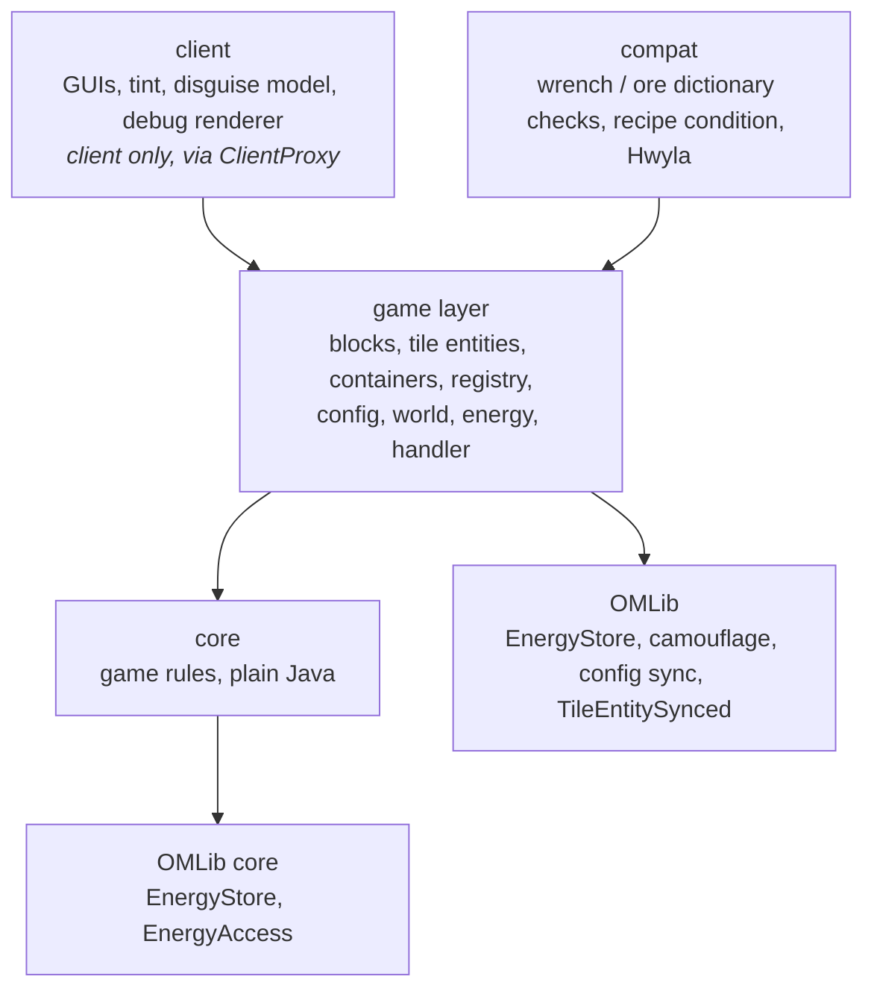
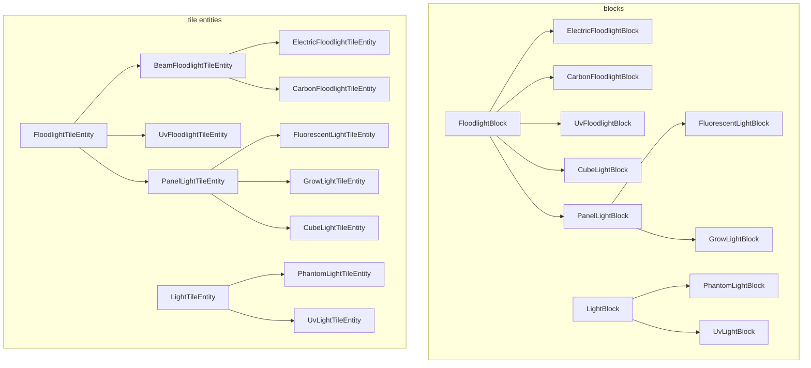

# Architecture

A guide to the code of Open Modular Lighting (OML) on Minecraft 1.12.2 (branch `1.12`) for people working on it: how it is layered, what lives where, how the main flows run, and how to add the common things.
It describes the code as it is; where it falls short of its own rules, the last section says so.

This is the 1.12.2 version of the guide.
The modern versions (Fabric 1.20.1 / 1.21.1, NeoForge, Forge 1.20.1) have their own on the branch `1.20.1+`; the 1.12.2 port has the same `core/` and `config/` (in Java 8) and the same class names, with the MCP-style package names of the OMTTeam 1.12 mods (`tileentity`, `container`, `client.gui`), without the Stonecutter build and the `platform/` layer, because 1.12.2 has one loader.
OML requires OMLib (`required-after:omlib`) and uses it for the energy buffer, the wrench, camouflage, the config sync, the tile entity base and more; see OMLib's `docs/architecture.md`.

Building, running, releases and the gameplay rules (beam shapes, state machine, power) are in `CLAUDE.md` of this repository (sections 4 to 6) and in the workspace `CLAUDE.md`; this document shows where they live in the code.
The ids of the old 1.7.10 mod are in [id-mapping.md](id-mapping.md).

## The idea in one paragraph

A **light** (floodlight, grow light, fluorescent light, cube light, UV floodlight) is a block with a tile entity that owns the state: on or off, inverted, power, mode and the cached shape of its beam.
The beam itself is made of **light blocks** (invisible phantom lights, or UV lights) that the light places in the air along the beam and then leaves in place.
Turning a light on or off only switches the `LIT` state of those light blocks; they are placed and removed only when the beam changes shape or the light is broken.
All game rules (beam shapes, which positions a ray reaches, which sources keep a light block alive, the on/off state machine, energy and fuel formulas) are plain Java in `core`, without any Minecraft class, so they are unit-tested in milliseconds.
The Minecraft-facing code around it translates between the game and the core and is kept as thin as possible.

## Layers

An arrow means "may use".
The other directions are forbidden:

- **core** uses only Java and itself (and OMLib's `core.energy`): no Minecraft, Forge, `com.mojang` or non-core OML packages.
  The `verifyCoreIsolation` task (part of `check`) fails the build if a file under `core/` imports `net.minecraft`, `net.minecraftforge`, `com.mojang` or a non-core OML package.
- **common code** never uses **client** code: client classes do not exist on a dedicated server.
  1.12 dev environments have no separate client source set, so `client` is a package; common code reaches it only through the proxy (`@SidedProxy`: `CommonProxy`, `client.ClientProxy`).
  Unlike OMLib, OMT and OMPD, this mod has no ArchUnit test for it yet.

### How core talks to the game

The core defines small interfaces for what it needs from the world; the game layer implements them.
This is the only place where the two meet, and the reason the core can be tested with fakes (`src/test/.../core/light/TestWorld`).

| Core interface | Implemented by (game layer) | What it gives the core |
| --- | --- | --- |
| `light.LightWorld` | `world.LevelLightWorld` | classifies a block position as a `Cell`: air, phantom light, UV light, opaque, transparent or unloaded |
| `state.PowerSource` | `energy.ElectricPower`, `energy.FuelPower` (through `energy.LightPower`) | whether the light can run this tick, and paying for it |
| `cluster.ClusterNode` | `tileentity.PanelLightTileEntity` | who a light is connected to, for the shared energy of touching lights |
| OMLib `core.energy.EnergyAccess` | the lights' `getEnergyAccess(side)` (the buffer of `ElectricPower`, or `energy.ClusterEnergy.View` for panel lights) | what other blocks may do with a light's energy (insert; extract is never allowed) |

Positions in core are the `Pos` class and directions the `Facing` enum (same ordinal order as `EnumFacing`); `world.Positions` converts both ways.
The tile entities own one core object each and forward to it: `FloodlightTileEntity` → `LightController`, `LightTileEntity` → `LightSources`, `PanelLightTileEntity` → `Cluster`.
A light's beam is the game-layer class `tileentity.LightBeam`, which calls `BeamCaster` and `ShapeDiff` and keeps the cached shape.

## Where things live

| Path | Contents | Shipped |
| --- | --- | --- |
| `src/main/java` | all code; client code in the `client` package | yes |
| `src/main/resources` | `mcmod.info` (templated), `assets/openmodularlighting`: models, blockstates, lang (`.lang`), textures, handwritten recipes | yes |
| `src/test/java` | JUnit 5 tests of the core, the config, the energy classes and the panel shapes | no |

Packages below `omtteam.openmodularlighting`:

| Package | Responsibility |
| --- | --- |
| (root) | `OML` (the `@Mod`: `MOD_ID`, `LOGGER`, `id(path)`, start-up), `CommonProxy` |
| `core.math` | `Pos`, `Facing`, `Rotation` (rotates the shapes to the facing) |
| `core.beam` | `BeamShape` (the ray patterns), `BeamMode` and `GrowMode`, `Spacing` (the thinning of light blocks along a beam), `Ray` |
| `core.light` | `BeamCaster` (walks the rays), `LightWorld` and `Cell`, `LightType`, `LightSources` (all and active sources of a light block), `ShapeDiff` |
| `core.state` | `LightController` (the on/off state machine), `PowerSource`, `FuelTimer`, `RecheckTimer` |
| `core.cluster` | `Cluster` and `ClusterNode`: connected groups with join, leave and split |
| `core.formula` | `CarbonFuel`, `GrowChance`, `EnergyCost` |
| `block` | `FloodlightBlock` (base of every light: facing and `LIT` in the metadata, drops) with its subclasses; `FloodlightInteraction` (right-click); `LightBlock` (base of the phantom and UV light blocks); `PanelShapes`; `LightproofGlassBlock` |
| `tileentity` | `FloodlightTileEntity` (base of every light) and subclasses, `LightBeam` (its cached beam and the re-cast); `LightTileEntity` (sources of a light block) with `PhantomLightTileEntity` and `UvLightTileEntity`; `LightSourceTileEntity` |
| `world` | `LightBlocks` (place, switch and remove light blocks), `LevelLightWorld`, `Positions`, `PosArrays` (flat `int` arrays: 1.12 cannot read long arrays back) |
| `energy` | `LightPower` with `ElectricPower` and `FuelPower`, `ClusterEnergy`, `Batteries` |
| `container`, `handler` | the container menus with `FloodlightContainer` as base; `OMLGuiHandler` (`IGuiHandler`) |
| `registry` | `ModBlocks`, `ModItems`, `ModTileEntities`, `ModCreativeTabs`, `ModRecipes` (smelting), `Registration` (the registry events) |
| `config` | the JSON config: `ConfigData` (fields), `@Comment`, `@Range`, `ConfigWriter`, `ConfigRanges`, `ConfigValidator`, `ConfigMigration`, `OMLConfig` (load, save, server values) |
| `compat` | `CommonTags` (wrench and wool checks without tags), `BlockEnabledCondition` (the recipe condition), `compat.hwyla` (the block info overlay) |
| `client` | `ClientProxy`, `ClientEvents` (models, colours, tooltip, debug renderer); `client.gui` (the floodlight screens), `client.camo` (`CamoModel`, the lamp overlay on the disguise), `client.render` (`FloodlightTint`, `LightBlockDebugRenderer`) |

From OMLib come, among others: the energy buffer and its Forge Energy adapter, `ICamoSupport` with the camouflage menu, `ConfigSync`, `tileentity.TileEntitySynced` (the base of all light tile entities), `container.WindowValues`, `AutomationItemHandler`, `InvUtil.dropItems` and `WorldUtil.getTileEntity`.

The block and tile entity hierarchies mirror each other:

The upper tree in each half is the **lights** (they have a facing, a GUI and a tick); the lower one is the **light blocks** they place (no GUI, no tick except the UV damage).

## How the main flows run

### Startup

`OML.preInit`:

1. `OMLConfig.init`: blocks and recipes read the config, so it comes first.
2. `ConfigSync.register(MOD_ID)` and `ConfigSync.registerValue(…)`: the JSON config is one value of OMLib's config sync (`OMLConfig.toJson` sent on login, `OMLConfig.applyServerConfig` applied by the client).
3. The event handlers: `Registration` (blocks and items in `RegistryEvent.Register`, tile entities in `ModTileEntities`) and `FloodlightInteraction`; then `proxy.preInit()`.

`init` registers the GUI handler and the smelting recipes (`ModRecipes`); the client proxy adds models, colours, the tooltip and the debug renderer in `ClientEvents`, and wraps the models of the camouflage-capable lights in `CamoModel`.
Recipes are handwritten JSON with the `openmodularlighting:block_enabled` condition (`compat.BlockEnabledCondition`, registered in `recipes/_factories.json`), loaded once from the local config.

### A light's tick (server)

`FloodlightTileEntity.update` (an `ITickable`):

1. `beforePower`: panel lights keep their cluster up to date and pull energy from it.
2. `power().prepare`: charge from the battery slot, or burn the next fuel item.
3. A re-cast is flagged if the shape key (mode, ranges) differs from the one the cached shape was cast with (`LightBeam.needsRecast`), or if the periodic `RecheckTimer` fires (every 10 to 30 s).
4. `LightController.tick(redstone, power, timeout)` returns a `TickResult`: re-cast or not, switch on, off or neither, and whether the light ran (and paid) this tick.
5. A re-cast runs first (`LightBeam.recast`), then the switch (`LightBeam.switchLights`), then the light's own `LIT` is set.
6. `afterTick` is the hook of subclasses (the grow light's growth ticks).

The state machine itself, with the timeout against flicker, is `core.state.LightController`; it knows nothing about blocks.

### Casting a beam

`LightBeam.recast`, called from the tick and at once from `FloodlightTileEntity.shapeChanged` (mode change):

1. `BeamCaster.cast(shape, origin, facing, lightType, new LevelLightWorld(world))` walks every ray of the shape and returns the positions that should hold a light block.
   A ray stops at an opaque or unloaded cell and passes through transparent ones without a position; the cone rules (the inner ray is skipped if its outer ray was blocked early) live here.
2. `ShapeDiff.between(cached, cast)` gives the positions that dropped out.
   For each, `LightBlocks.leave` removes this light as a source; a light block with no sources left removes itself.
3. Every cast position is joined through `LightBlocks.join`: it places a light block in air (or where `LightBlock.canReplace` allows), then adds this light as a source.
   Joining positions that are already covered is a no-op, so this also repairs light blocks lost while a chunk was unloaded.
4. The positions that joined become the cached shape (saved with the tile entity as a flat `int` array, so a reload does not need a cast).

`BeamCasterTest` checks `BeamCaster` against the original 1.7.10 loops kept in the test sources (`Legacy1710Beams`, filtered by the same thinning) in random worlds.

### Light blocks and their sources

A `LightTileEntity` stores two lists: `sources` (every light that reaches this block) and `activeSources` (those that are on), in `core.light.LightSources`.
Every change returns an `Effect` (`NONE`, `TURN_ON`, `TURN_OFF`, `REMOVE`) which `LightBlocks.apply` carries out on the block: `LIT` is `!activeSources.isEmpty()`, and the block goes away when `sources` is empty.
So several floodlights can share one block, and it stays lit as long as one of them is on.

`LightBlocks` always uses `LightBlocks.FLAGS` (clients are told, no observers or neighbour notification).
Without that, every toggle would update the next light block and start re-cast chains.

Light blocks do not tick (there can be thousands); they react to the world instead:

- `neighborChanged` and the break callback call `requestRecastOfSources()`, which only flags the sources; the light re-casts on its next tick, never inside the neighbour callback.
- `randomTick` calls `LightTileEntity.refresh()`: sources whose tile entity is gone, or no longer covers this position, are dropped, `LIT` is corrected and the block removes itself if nothing is left.
  Sources in unloaded chunks are left alone (`SourceStatus.UNKNOWN`).

The phantom light is `Material.AIR` on 1.12 (so `isAir` is true, as in 1.7.10); falling blocks, trees, pistons and explosions treat it as air, and random ticks still work.
`LevelLightWorld` and `LightBlocks.join` therefore check the light blocks **before** `isAir`.
The UV light block is the exception that ticks: while lit it hurts every living entity inside it once a second (`UvLightTileEntity.update`).

Forge recreates a mod tile entity on every state change unless `shouldRefresh` says otherwise; OMLib's `TileEntitySynced` replaces it only when the block changes, which is what lets `LIT` switch without wiping a light.

### Power and fuel

A light's `LightPower` is chosen by its tile entity: `ElectricPower` (an OMLib `EnergyStore` of 50 000 E plus a battery slot) or `FuelPower` (a `FuelTimer` plus a fuel slot).
`prepare` runs before the logic each tick, `PowerSource.canRun()` / `run()` is what `LightController` calls.
The numbers are in `core.formula` (`EnergyCost`, `CarbonFuel`, `GrowChance`).

Outside access goes through capabilities on the tile entities:

- Energy: OMLib's `core.energy.EnergyAccess`, exposed as Forge Energy by OMLib's `EnergyAccessStorage`.
  Only inserting is possible; there is no extraction.
- Items: OMLib's `AutomationItemHandler` over the slot (insert what the slot accepts, extract nothing); `InvUtil.dropItems` spills the slot when the block breaks.
- Battery slot and fuel values: `energy.Batteries` (items with extractable Forge Energy) and `TileEntityFurnace.getItemBurnTime`.

### Shared energy of panel lights

Fluorescent, grow and cube lights (`PanelLightTileEntity`) that touch and face the same way form a `core.cluster.Cluster` (cube lights: any face, cube lights only).
The cluster is in memory only: a light joins on its first tick, leaves when removed, and a possible split is found in `refresh()` once per tick, so breaking a wall of lights costs one flood fill.
Each light keeps its own buffer; `ClusterEnergy` shows the whole cluster to the outside (inserting fills the emptiest light first) and lets a light that cannot pay take from the fullest others.

### A click on a light

`FloodlightInteraction` listens to `PlayerInteractEvent.RightClickBlock` (it fires before the sneak check, also for wrenches that do not bypass sneaking) and handles one action per method:

- sneak with an empty hand: toggle invert; stick or wrench: `configure` (cycle the mode, turn the small fluorescent light); wrench plus sneak: dismantle; dye or wool: set the colour;
- anything else opens the GUI: `OMLGuiHandler` creates `ElectricFloodlightContainer` or `CarbonFloodlightContainer` on the server and the screen from `ClientProxy.createGui` on the client.
  The container syncs its long values through OMLib's `WindowValues`.
  The electric, carbon and UV floodlights also get a Camouflage button that opens OMLib's camouflage menu.

Changes that affect the beam (`setMode`) end in `shapeChanged()`, which re-casts at once.
The server is the only place that changes state; the screens only show it, and the colour and the disguise reach the client in the tile entity's update tag.
The disguise is drawn by `client.camo.CamoModel`: it wraps the light's blockstate model and emits the disguise's quads per render layer plus the lamp quads of the light's own model (tint index 1) on the front face.

### Config

`OMLConfig.get()` is the only way to read a value, and the value is never cached by the caller: on a client connected to a server it returns the server's config (synced on login through OMLib's `ConfigSync`).
See "A config value" below for adding one.

## How to add …

### A beam shape or mode

Add the shape to `core.beam.BeamShape` / `BeamMode`, with a unit test in `core/beam` and, if the new shape belongs in the comparison, an entry in `Legacy1710Beams` that `BeamCasterTest` compares against.
The tile entity returns it from `currentShape()` and puts everything it depends on into `shapeKey()`, so a change triggers a re-cast.

### A light

1. A block extending `FloodlightBlock` (or `PanelLightBlock`) and a tile entity extending `FloodlightTileEntity` (or `PanelLightTileEntity`); the tile entity chooses `power()`, `currentShape()` and `shapeKey()`.
2. Register block, item and tile entity in `ModBlocks`, `ModItems`, `ModTileEntities`; the energy and item capabilities are on the tile entity.
3. Blockstate (metadata: the facing in bits 0–2, `LIT` in bit 3; the blockstate JSON lists every property), model, `.lang` entries (`en_us`, `de_de`, `ru_ru`), and a handwritten recipe with the `block_enabled` condition.
4. An entry in `docs/id-mapping.md` if it replaces a block of the old mod.
Textures are made by a human: use a placeholder and say which images are missing.
Block textures must be square (the panel textures are 64 × 64 with a transparent lower half).

### A config value

Add a field to the right section of `config.ConfigData` with `@Comment` and `@Range`; the file, its comments and the range check follow from them.
Only `int`, `double`, `boolean` and `List<String>` are supported.
If you change a **default**, raise `ConfigMigration.CURRENT_VERSION`, add a step and a test.

### Client code

Anything that touches `Minecraft`, rendering or screens goes into `client` and is reached from common code through the proxy.

### Something shared with the other mods

Energy, camouflage, the wrench, config sync and tile entity helpers belong in OMLib, not here.

### Recipes, loot

No datagen on 1.12: recipes are handwritten JSON in `assets/openmodularlighting/recipes` with the `block_enabled` condition, smelting is code (`ModRecipes`), blocks drop through `getDrops` (the settings go into the item's `BlockEntityTag`).

## Rules the build checks

`./gradlew build` (or `check`) fails when one of these is broken:

| Rule | Checked by |
| --- | --- |
| core uses only Java and core | the `verifyCoreIsolation` task |
| core rules and the config behave as specified | unit tests in `src/test` |
| the beam shapes still equal the reference loops (with thinning) | `BeamCasterTest` against `Legacy1710Beams` |
| equals and hashCode of the core value classes | `core.EqualsContractTest` (EqualsVerifier) |
| formatting (spaces, trailing whitespace, final newline) | `spotlessCheck` |
| the changelog has a section for the version being published | `publishMods` |

There are no GameTests on 1.12: check in-game behaviour by hand with `runClient` (single player needs no EULA) or the workspace's `runenv`.
The client (screens, models, tint) is not covered by any test.
The ArchUnit, JaCoCo and PMD setup of the other mods is not on this branch.

## Measuring code quality

| Tool | Command | Output |
| --- | --- | --- |
| Mutation testing of `core` (PIT, on demand) | `./gradlew pitest` | `build/reports/pitest/index.html` |

Run Gradle with a JDK 17+ in `JAVA_HOME`; the mod compiles and tests on the Java 8 toolchain.
PIT plants small mistakes in core (a flipped condition, `<` instead of `<=`, a removed call) and runs the unit tests against each one; a survivor marks behaviour the tests do not pin down, unless the change cannot be noticed (an equivalent mutant).

## Known weak spots

Things that make the code harder to work with than they should be.
They are known, not hidden:

- **No architecture test.** The rules "common code never uses `client`" and "no new package cycles" are not enforced here as in OMLib, OMT and OMPD; the `ArchitectureTest` of those mods could be ported.
- **`FloodlightTileEntity` does a lot:** ticking, settings, the colour, the disguise, the slot and saving.
  The beam (cast, diff and shape cache) is already in `LightBeam`; the slot would be the next candidate to move out.
- **Phantom lights beside skipped positions.** Because of the thinning (`core.beam.Spacing`), a block change next to a position without a light block may reach no light block at all, so the beam notices it only at the periodic re-check (10 to 30 s).
- **The invert toggle** is OML's own; OMLib's `core.machine.MachineMode` is not used, because the 1.20.1+ lights do not work that way (postponed by the user).
- **The client is untested** except by hand: placing, beams, GUIs, disguise rendering and tint need a check with `runClient`.
- **`core/` and `config/` are kept in step with the `1.20.1+` branch by hand**, apart from Java 8 syntax and the energy classes, which come from OMLib.
